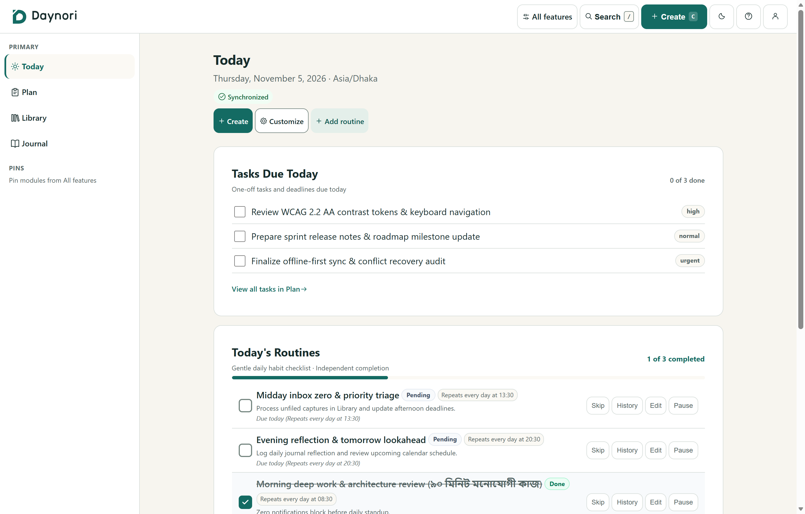
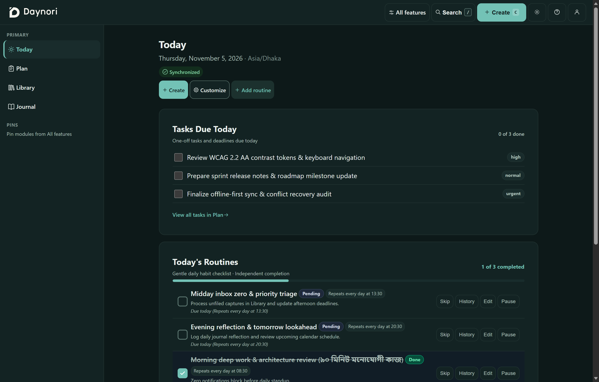
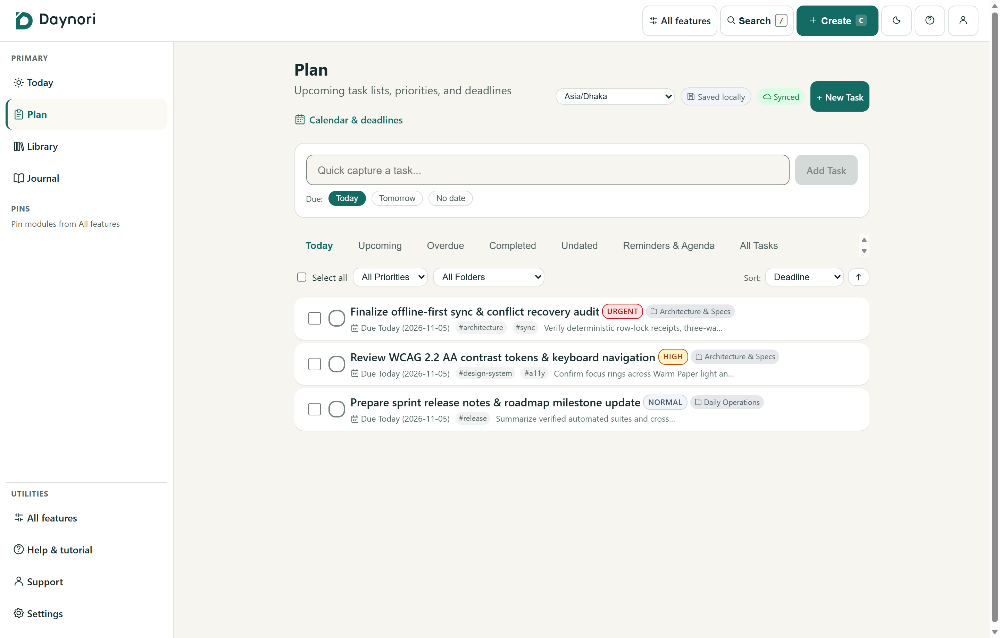
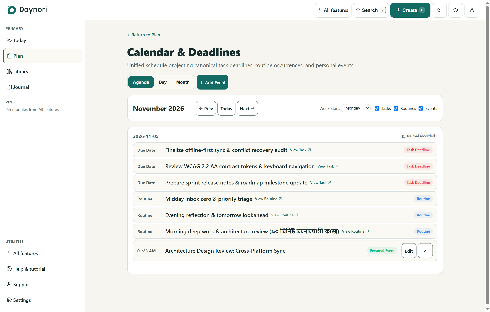
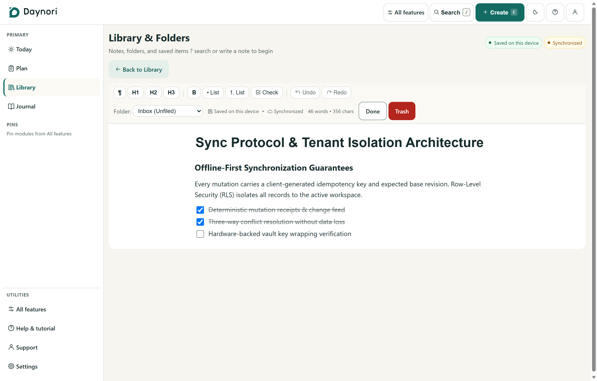
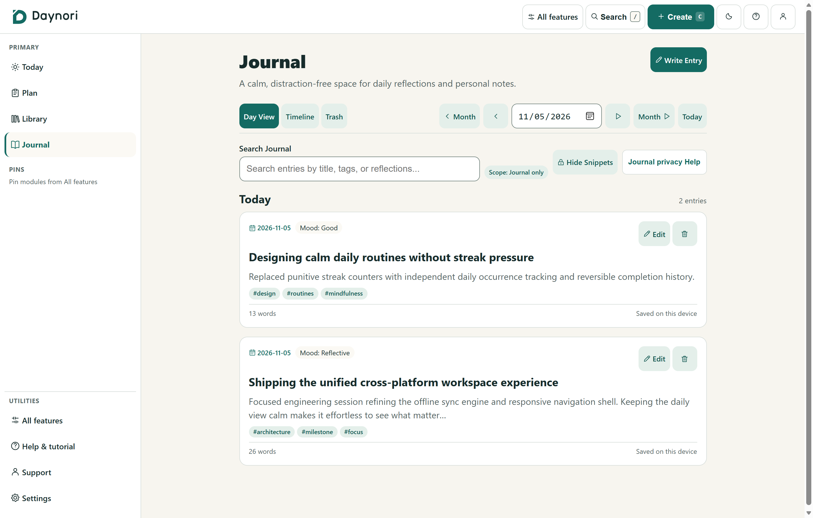
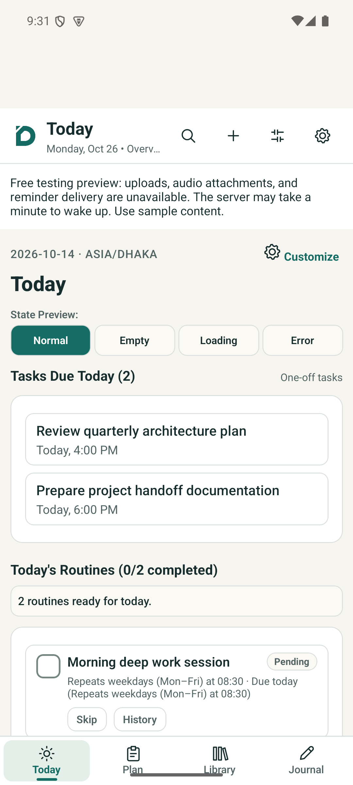
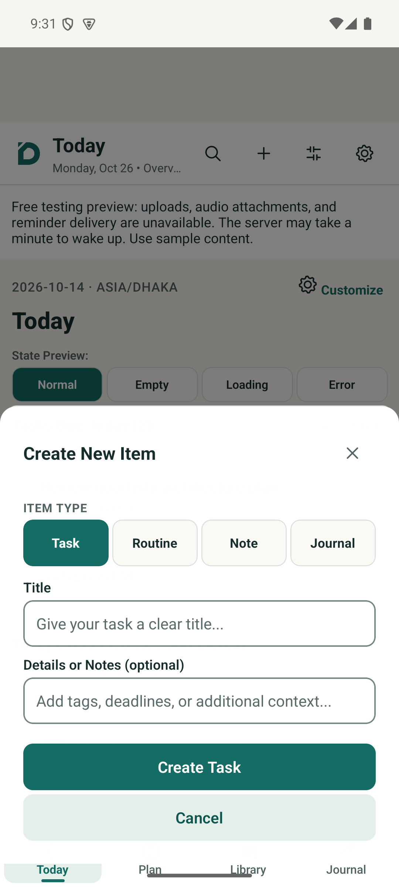
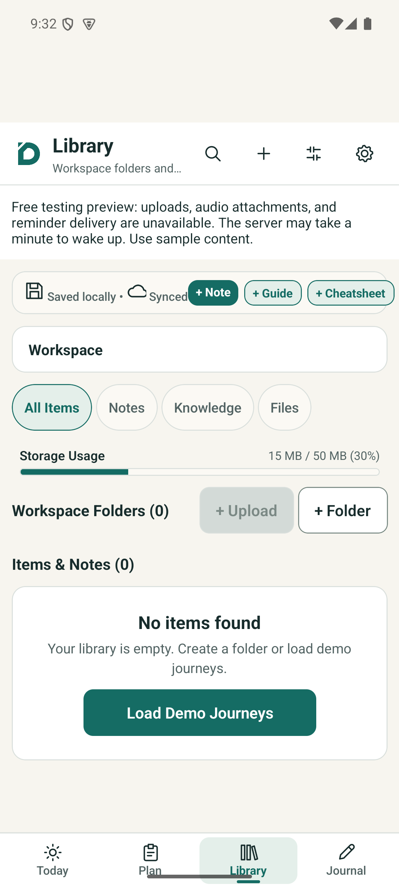
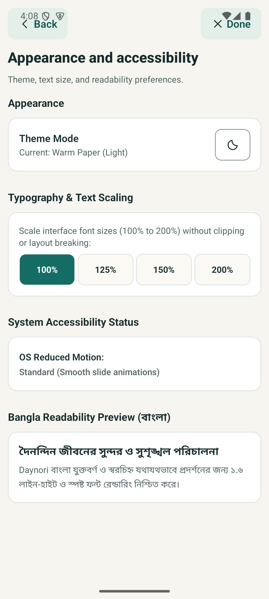

<div align="center">

<picture>
  <source media="(prefers-color-scheme: dark)" srcset="assets/brand/daynori-logo-inverse.svg" />
  <source media="(prefers-color-scheme: light)" srcset="assets/brand/daynori-logo.svg" />
  
</picture>

### **Your day, gathered.**

A calm, offline-first personal organizer for notes, routines, tasks, journals, calendar schedules, and everyday life across **Android** and **responsive web**.

[](#license)
[](https://www.typescriptlang.org/)
[](https://nextjs.org/)
[](https://expo.dev/)
[](https://reactnative.dev/)
[](https://fastify.dev/)
[](https://supabase.com/)
[](https://nodejs.org/)
[](https://pnpm.io/)

[**Live Web Preview**](https://daynori-web-preview.onrender.com) · [**Android APK**](https://github.com/mkamrul9/dayNori/releases/download/preview-2026-10-22/daynori-preview-arm64.apk) · [**API Health**](https://daynori-api-preview.onrender.com/v1/ready) · [**Architecture Blueprint**](docs/blueprint.html) · [**Documentation**](docs/README.md) · [**Roadmap**](docs/roadmap/README.md)

</div>

---

##  Overview

**Daynori** brings your notes, prioritized tasks, recurring routines, private reflections, calendar deadlines, and structured folders into one cohesive workspace. Engineered as a strict TypeScript monorepo with shared domain rules and an offline-first synchronization protocol, Daynori is built for **Android** and **responsive web PWA** first, with iOS gated behind a separate feasibility review.

> **Status:** Active development — testing preview with open release gates. Web, mobile, API, worker, and shared-package implementations exist; their presence does not establish that every function is ready. The [Version 2 roadmap](docs/roadmap/v2/README.md) defines redesign, learning, support, mobile, notifications, and assistant work. Phase 65 published a [function register](docs/roadmap/v2/function-register.json) and [readiness baseline](docs/roadmap/v2/readiness-baseline.md); see the [progress register](docs/roadmap/progress.json) for actual results.

---

##  Product Showcase

### Desktop & Responsive Web Application

<div align="center">
  <picture>
    <source media="(prefers-color-scheme: dark)" srcset="assets/screenshots/web-today-dark.png" />
    <source media="(prefers-color-scheme: light)" srcset="assets/screenshots/web-today-light.png" />
    
  </picture>
  <p><sub><b>Today Workspace</b> — Unified daily command center with prioritized tasks due today, recurring habit checklists, bilingual English/Bangla typography, and real-time sync telemetry (automatically adapts to your GitHub Light or Dark theme above).</sub></p>
</div>

|  **Warm Paper (Light Mode)** |  **Deep Ink (Dark Mode)** |
| :------------------------------------------------------------------------------------------------------------------: | :----------------------------------------------------------------------------------------------------------------: |
|              |              |
|         <sub>High-contrast warm paper palette (`#F7F5EF`) tuned for daytime reading and calm planning.</sub>         |       <sub>Low-glare deep ink palette (`#121A1D`) with balanced semantic contrast for night sessions.</sub>        |

|    **Plan & Prioritized Tasks**    |  **Unified Calendar & Deadlines** |
| :---------------------------------------------------------------------------------------------------------------------------------: | :----------------------------------------------------------------------------------------------------------------------------: |
|                                   |                              |
| <sub>Quick-capture bar, smart schedule horizons (`All`, `Today`, `Upcoming`, `Overdue`), priority badges, and folder scoping.</sub> |   <sub>Cross-module day schedule projecting task deadlines, routine windows, personal events, and journal indicators.</sub>    |

|         **Rich AST Note Editor & Library**         |  **Private Reflection Journal** |
| :-----------------------------------------------------------------------------------------------------------------------------------------: | :-------------------------------------------------------------------------------------------------------------------------: |
|                                        |                       |
| <sub>Structured document editor with interactive checklists, live word/character counts, local autosave, and conflict-safe revisions.</sub> |  <sub>Daily reflection entries with mood tracking, tags, word-count telemetry, and one-click content privacy toggle.</sub>  |

### Native Android Application

<div align="center">

|                                     **Today Command Center**                                     |                                         **Quick Capture Sheet**                                         |                                     **Library & Storage Quota**                                      |                                                **Appearance & Bangla Preview**                                                 |
| :----------------------------------------------------------------------------------------------: | :-----------------------------------------------------------------------------------------------------: | :--------------------------------------------------------------------------------------------------: | :----------------------------------------------------------------------------------------------------------------------------: |
|  |  |  |  |
|       <sub>Tasks due today, routine progress, and thumb-friendly bottom navigation.</sub>        |           <sub>Instant modal creation for notes, tasks, routines, and journal entries.</sub>            |           <sub>Filterable workspace repository with folder hierarchy and quota bar.</sub>            |                   <sub>Theme selection, font scaling (`100%`–`200%`), and `বাংলা` readability preview.</sub>                   |

</div>

---

##  Core Modules & Capabilities

Every module Icon below is generated directly from Daynori's shared vector icon specification ([`packages/design-tokens/src/icons.ts`](packages/design-tokens/src/icons.ts)):

| Module                                                                                                            | Capabilities                                                                                                                 |
| :---------------------------------------------------------------------------------------------------------------- | :--------------------------------------------------------------------------------------------------------------------------- |
|  **Notes**               | Structured AST notes with headings, checklists, callouts, local autosave, offline drafts, and explicit conflict resolution   |
|  **Tasks**       | Prioritized tasks (`Urgent`, `High`, `Normal`, `Low`) with deadlines, subtasks, timezone-aware due dates, and smart horizons |
|  **Routines**          | Daily and weekly recurring habit checklists with per-occurrence completion tracking and progress indicators                  |
|  **Journal**          | Personal daily reflections with mood tracking, structured prompts, word counts, and privacy-first content controls           |
|  **Files & Folders**   | Hierarchical workspace folders, pinned collections, and quota-tracked file organization                                      |
|  **Calendar**        | Unified daily and monthly schedule integrating events, task due dates, routines, and journal entries                         |
|  **Expenses**          | Personal expense logging, categorization, and budget visibility within the workspace                                         |
|  **Vault**               | End-to-end encrypted storage for sensitive records _(gated behind dedicated threat-model release checks; planned)_           |
|  **Global Search**     | Cross-module full-text search with instant type filters and keyboard navigation                                              |
|  **Custom Sections**  | User-composed workspace views built from approved, schema-validated block layouts                                            |
|  **Audio Capture** | Voice note recording and audio attachment workflows                                                                          |
|  **Reminders**           | Timezone-aware scheduled notifications across tasks, routines, and events                                                    |
|  **Guided Help**         | Interactive onboarding, contextual feature tours, and bilingual English/Bangla typography support                            |

---

##  Architecture & Monorepo Layout

```text
daynori-monorepo/
├── apps/
│   ├── web/            # Next.js 15 · React 18 · responsive offline-capable PWA
│   ├── mobile/         # Expo SDK 52 · React Native 0.76 · Android-first client
│   ├── api/            # Fastify modular monolith · workspace-scoped REST API
│   └── worker/         # Durable background job & reminder processor
├── packages/
│   ├── domain/         # Shared domain entities, invariants, and business rules
│   ├── contracts/      # Zod API contracts, cursor pagination, and type-safe schemas
│   ├── api-client/     # Type-safe HTTP client with offline mutation outbox
│   ├── sync/           # Offline-first synchronization and conflict resolution protocol
│   ├── design-tokens/  # Brand palette, typography, spacing, and SVG icon vectors
│   ├── config/         # Environment validation and runtime configuration utilities
│   ├── ui-web/         # Accessible web component primitives
│   ├── ui-mobile/      # Native mobile component primitives
│   └── test-utils/     # Deterministic test fixtures and workspace builders
├── assets/
│   ├── brand/          # Official SVG/PNG marks, adaptive icons, and module badges
│   └── screenshots/    # Verified desktop web and Android product screenshots
├── docs/               # Product specs, architecture, ADRs, and phased roadmap
├── infra/              # Render / cloud deployment definitions and operational scripts
├── supabase/           # PostgreSQL migrations and 74-entry managed schema
└── tests/              # Integration, contract, security, and performance suites
```

### Core Engineering Principles

-  **Offline-First Synchronization** — SQLite on Android and IndexedDB on web with durable mutation receipts, revision tracking, and explicit conflict handling.
-  **Strict Tenant & Workspace Isolation** — Every API request, database query, background job, and search index entry is strictly scoped to the authenticated workspace and active membership.
-  **End-to-End Type Safety** — Strict TypeScript with zero broad `any` types and runtime Zod validation at every external trust boundary.
-  **Accessible & Multilingual by Default** — WCAG AA contrast ratios, full keyboard and screen-reader alternatives to drag interactions, scalable typography (`100%`–`200%`), and native Latin + Bangla (`Noto Sans Bengali`) rendering.

---

##  Tech Stack

| Layer              | Technology                                                                                    |
| :----------------- | :-------------------------------------------------------------------------------------------- |
| **Web Client**     | Next.js 15, React 18, responsive PWA with Service Worker & IndexedDB persistence              |
| **Mobile Client**  | Expo SDK 52, React Native 0.76, SQLite local store (Android-first)                            |
| **Backend API**    | Fastify modular monolith with route-level workspace authorization & rate limiting             |
| **Database**       | Supabase PostgreSQL with 74-entry managed schema and row-level tenancy                        |
| **Authentication** | Supabase Auth with Argon2id / TLS runtime session management                                  |
| **Object Storage** | Supabase private bucket storage with signed URL access controls                               |
| **Sync Engine**    | Custom delta pull / idempotent push protocol in `@personal-organizer/sync`                    |
| **Worker**         | Durable background queue processor for reminders, exports, and maintenance                    |
| **Design System**  | `@personal-organizer/design-tokens` with automated SVG/PNG asset pipeline                     |
| **Quality & CI**   | Vitest (unit, contract, integration, security, performance), ESLint, Prettier, GitHub Actions |

---

##  Getting Started

### Prerequisites

- **Node.js** ≥ 24.21.0
- **pnpm** ≥ 9.0.0
- **Android Studio / SDK** _(optional, for native Android emulator builds)_

### Installation

```bash
# Clone the repository
git clone https://github.com/mkamrul9/dayNori.git
cd dayNori

# Install workspace dependencies
pnpm install

# Copy environment template and configure local/Supabase credentials
cp .env.example .env
```

### Running in Development

```bash
# Start the Next.js web application
pnpm dev:web

# Start the Fastify API server
pnpm dev:api

# Start the Expo Android application
pnpm dev:mobile

# Start the durable background worker
pnpm dev:worker
```

### Verification & Quality Gates

```bash
pnpm build                          # Build all shared packages and applications
pnpm typecheck                      # Run strict TypeScript checks across all workspaces
pnpm test                           # Execute unit, contract, integration, security & perf suites
pnpm lint                           # Run ESLint across the monorepo
pnpm format:check                   # Verify Prettier formatting
pnpm audit                          # Run secret scanning and dependency vulnerability checks
node scripts/validate-planning.mjs  # Validate documentation links, roadmap, and encoding
node scripts/check-brand-assets.mjs # Verify brand logos, app icons, and SVG/PNG integrity
```

---

##  Testing Preview

A **$0 testing preview** is deployed for live evaluation:

| Platform            | Access Link                                                                                                                                | Notes                               |
| :------------------ | :----------------------------------------------------------------------------------------------------------------------------------------- | :---------------------------------- |
| **Web Application** | [daynori-web-preview.onrender.com](https://daynori-web-preview.onrender.com)                                                               | Responsive desktop & mobile web PWA |
| **API Readiness**   | [daynori-api-preview.onrender.com/v1/ready](https://daynori-api-preview.onrender.com/v1/ready)                                             | Live health and readiness probe     |
| **Android APK**     | [Download `daynori-preview-arm64.apk`](https://github.com/mkamrul9/dayNori/releases/download/preview-2026-10-22/daynori-preview-arm64.apk) | ARM64 device build (Android 7.0+)   |

> **Preview Scope Note:** The zero-cost preview environment intentionally disables binary file/audio object uploads and background push reminder delivery, displaying transparent in-app capability banners. Screen-lock preferences provide UI privacy only and do not encrypt local storage; end-to-end encrypted Vault storage remains gated behind its dedicated security release phase.

---

##  Documentation

| Document                                                    | Purpose                                                           |
| :---------------------------------------------------------- | :---------------------------------------------------------------- |
| [Documentation Index](docs/README.md)                       | Master index for product, architecture, design, and operations    |
| [Product Requirements](docs/product/requirements.md)        | Functional specifications and acceptance criteria across modules  |
| [System Architecture](docs/architecture/system-overview.md) | Component boundaries, data flow, and platform adapters            |
| [Design System](docs/design/design-system.md)               | Color tokens, typography scale, accessibility, and motion rules   |
| [Icon Artwork Spec](docs/design/icon-artwork.md)            | Original folded-D brand mark and 24x24 custom UI icon geometry    |
| [Phased Roadmap](docs/roadmap/README.md)                    | Complete delivery plan (Phases 00–63 and Version 2 Phases 64–103) |
| [Architecture Decisions (ADRs)](docs/decisions/README.md)   | Recorded architectural tradeoffs and engineering rationale        |
| [Contributing & Workflow](CONTRIBUTING.md)                  | Phase execution protocol, verification gates, and Git conventions |
| [Interactive Blueprint](docs/blueprint.html)                | Self-contained visual architecture explorer _(open in browser)_   |

---

##  Roadmap

Daynori is developed through a strict phased engineering model. Each phase defines bounded scope, dependencies, automated verification suites, and a recorded completion report. The foundational **00–63** roadmap is preserved alongside the [Version 2 roadmap](docs/roadmap/v2/README.md) (**Phases 64–103**):

- **Phases 01–08** — Monorepo foundation, strict TypeScript/CI gates, design tokens, and shared domain contracts
- **Phases 09–15** — Authentication, workspace tenancy, RBAC, and hierarchical folder organization
- **Phases 16–26** — Core personal organizer modules (Notes, Tasks, Routines, Journal, Files, Calendar)
- **Phases 27–33** — Scheduled reminders, user personalization, cross-module search, and knowledge base
- **Phases 34–43** — Quality hardening, multi-account switching, expenses, audio capture, and custom sections
- **Phases 44–56** — Encrypted Vault, cloud drive connectors, shared rooms, and assistant workflows _(planned/gated)_
- **Phases 57–63** — Commercial readiness, security verification, and store release gates
- **Phases 64–103 (V2)** — Focused daily UX redesign, interactive guided learning, Android preview distribution, and runtime hardening

Track live phase status in [`docs/roadmap/progress.json`](docs/roadmap/progress.json).

---

##  Contributing

This is a proprietary repository. External pull requests are **not accepted** at this time.

- For questions, bug reports, or architectural discussions, please open an issue via [GitHub Issues](https://github.com/mkamrul9/dayNori/issues).
- Internal contributors and coding agents must follow [AGENTS.md](AGENTS.md), [CONTRIBUTING.md](CONTRIBUTING.md), and the [engineering handoff guide](docs/engineering/handoff.md).

---

##  License

**Copyright © 2026 Md Kamrul Islam. All Rights Reserved.**

This software is proprietary. No license, right, or interest is granted to any person or entity. You may not copy, modify, distribute, sublicense, or use this software in whole or in part without prior written authorization from the copyright holder.

The availability of source code in a public repository does **not** constitute a grant of any license or permission. Public visibility is provided solely for review, transparency, and portfolio evaluation.

See [LICENSE](LICENSE) for the full terms.

---

<div align="center">


<br />

**Daynori** · Built with care by [Md Kamrul Islam](https://github.com/mkamrul9)

</div>
