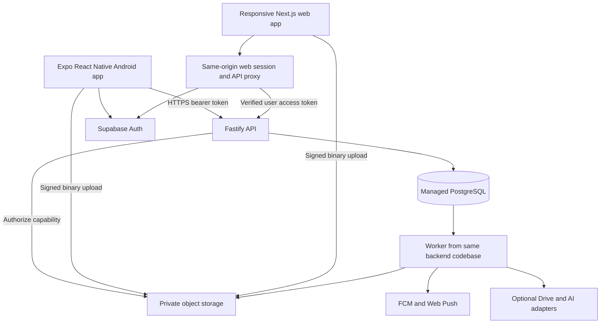

# System overview

Status: accepted planning baseline; implementation follows the phased roadmap.

## System shape

Build one product with a private personal workspace first. Use a TypeScript monorepo, independently deployable clients, and a backend modular monolith. This keeps domain behavior consistent while allowing native mobile interactions and responsive browser interactions to fit their platforms.

API and worker share one source tree and database, but run as separate processes. They communicate through durable database jobs and outbox records. Start with one deployment region near the intended users; benchmark from Bangladesh before choosing it. Do not claim global latency from a multi-region CDN when writes and private documents still use a single region.

## Proposed technology baseline

- Mobile: Expo React Native, Expo Router, TypeScript, Android first. Use platform permissions and development builds; iOS is a later validation track.
- Web: Next.js responsive app with semantic HTML, keyboard navigation, and a same-origin session layer. Installable PWA support follows reliable browser caching and sync, rather than being treated as mobile feature parity.
- Backend: Fastify with modules for identity, organization, content, planning, files, finance, sync, integrations, rooms, and assistance. Use schema validation and explicit authorization on every route.
- Data: Supabase-managed PostgreSQL and Supabase Auth. Use SQL migrations and a typed query layer such as Drizzle after the foundation compatibility check. Auth session handling follows supported SDK flows; do not implement password storage.
- Binary data: private Supabase Storage through a provider interface. It provides an S3-compatible option, but the first adapter uses its supported upload/signing API; do not assume interchangeable signing semantics across providers.
- Local data: encrypted SQLite on mobile; IndexedDB on web behind a repository adapter. Browser offline persistence is an explicit trusted-device setting, with clear-data controls. Vault ciphertext may persist; vault plaintext must not.
- Durable work: PostgreSQL job tables, leases, retry policy and transactional outbox. Add Redis or a dedicated broker only when queue metrics prove a need.
- Search: local text search and PostgreSQL full-text search for ordinary data. Introduce vector search only for a separately consented AI feature. Vault search is local and available only while unlocked.
- Delivery: Android FCM, browser Web Push, and later APNs. Local notifications complement server notifications; they do not eliminate platform delivery limits.

Exact library versions belong in the later lockfile and phase report, not in this planning document. Use current stable compatible releases and record upgrade ownership.

## Shared code and dependency boundaries

Share domain rules, validation schemas, DTOs, sync state machine, time/money helpers, design tokens, and test fixtures. Do not force web HTML components and native views into one component layer.

- `packages/domain`: pure business rules. No React, network, vendor SDK, database, or environment reads.
- `packages/contracts`: versioned public DTOs and transport schemas; no ORM entities or secret configuration.
- `packages/design-tokens`: semantic colors, spacing, typography and motion values; platform adapters apply them.
- `packages/sync`: pure operation queue, conflict and checkpoint logic; repositories supply persistence.
- `packages/config` and `packages/test-utils`: build/lint presets and cross-platform fixtures; clients must not import server configuration.
- `apps/mobile` and `apps/web`: presentation, navigation, platform adapters and local repositories.
- `apps/api`: transport, application services, authorization, repositories and vendor adapters. Modules use explicit application interfaces rather than importing each other's SQL directly.
- `apps/worker`: worker bootstrap using backend application services. Request handlers never wait for AI, malware scanning, exports, or large Drive transfers.

Server application services own transactions. A transaction commits domain rows, revision/change records, idempotency receipts and outbox events together. Any client-supplied workspace ID is a selector, never proof of access.

## Common organization model

A workspace has one canonical folder hierarchy containing mixed typed items. A `Software` folder can hold a note, PDF, todo and guide together. Each item has one primary folder, or belongs to Inbox when unfiled. Sections such as Notes, Tasks and Journal are filtered views over that same workspace; they do not own separate copies or competing folder trees. Built-in views have safe defaults but can be renamed, reordered, hidden and restored. Custom sections select approved view configurations, templates and bounded typed fields. They cannot execute JavaScript, SQL, HTML, expressions with side effects, or user-installed plugins. Tags, item links, search and Today/calendar views provide additional discovery.

Folders and items remain within one workspace and security scope. Vault maintains an encrypted folder hierarchy within its separate scope; ordinary/vault moves require re-encryption and cleanup. A mixed ordinary folder cannot expose an encrypted vault item's title through a module filter. Links never bypass the security boundary.

## Platform capability contract

- Typed notes, routines, todos, journals, file organization, expenses and custom sections target mobile and web parity.
- Biometric unlock is native where available. Browser vault unlock begins with a strong vault passphrase; WebAuthn-assisted unlock is a separate feasibility gate.
- Browser reminders require supported notification/service-worker permissions. A closed browser, unsupported device, or denied permission cannot guarantee a reminder at a precise time.
- Exact Android alarm mode is opt-in and subject to permission, store policy, native implementation and physical-device testing. Ordinary reminders remain best effort.
- Audio recording is a separate file workflow requiring microphone permission and a platform-specific recorder. Its one file record can link to an existing typed note, journal or knowledge item without changing keyboard-only note creation. Uploaded audio remains playable without recording access. Transcription is separate opt-in processing.
- Drag-and-drop is an enhancement; all organization actions must have accessible menu/button alternatives.

## Explicit exclusions for the first private release

No microservices, real-time multi-user rich-text editing, public marketplace, user code execution, automatic access to all Drive files, bank credentials, medical alarm guarantees, or server access to vault plaintext. Rooms, AI, and Drive integration follow a stable and recoverable private core.

## Revisit triggers

Revisit deployment topology when a measured workload exceeds the performance budget after indexing and batching; revisit sync conflict strategy when users lose time resolving edits; revisit provider choice when actual regional latency, backup cost, security controls, or usage limits fail the required release gate. Record evidence in an ADR before adopting a new dependency.
