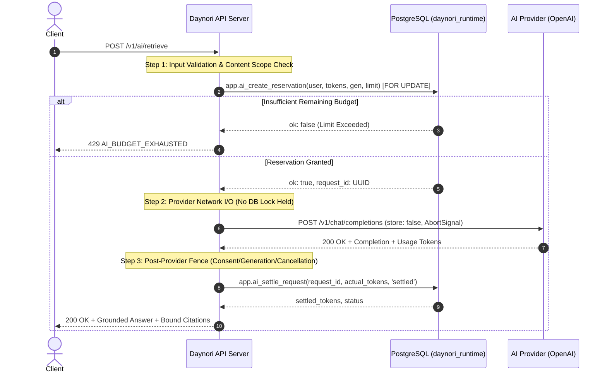

# AI Budget, Cancellation, and Operations Guide (2026-11-06)

**Phase:** Phase 90 — AI provider consent, privacy, and operating decisions  
**Review date:** 2026-11-06  
**Audience:** Platform operators, reliability engineers, security team  

---

## 1. Budget Lifecycle & Concurrency-Safe Reservations

Daynori tracks and enforces AI compute consumption through a durable, database-backed reservation and settlement engine. Because external provider calls incur direct financial cost, budget limits are enforced **prior to initiating network I/O**, preventing race conditions and unbounded spending.



---

## 2. Durable Reservation Mechanics

1. **Window Definition:**
   - Budget windows align to calendar months (`date_trunc('month', now())::date`).
   - Windows are tracked in `app.ai_budget_windows` with primary key `(user_id, window_start)`.
   - Constraints enforce `reserved_tokens >= 0`, `spent_tokens >= 0`, and `budget_limit > 0`.

2. **Atomic Reservation (`app.ai_create_reservation`):**
   - Executed under a `FOR UPDATE` lock on the user's current month window row.
   - Evaluates: `spent_tokens + reserved_tokens + p_tokens > budget_limit`.
   - If exceeded, returns `ok: false, request_id: NULL` without modifying table state.
   - If permitted, increments `reserved_tokens = reserved_tokens + p_tokens`, inserts a row into `app.ai_budget_requests` with status `'reserved'`, and returns `request_id`.

3. **Idempotent Settlement (`app.ai_settle_request`):**
   - Executed after provider I/O completes, fails, or cancels.
   - Releases the reserved tokens: `reserved_tokens = GREATEST(0, reserved_tokens - v_req.reserved_tokens)`.
   - Records actual usage: `spent_tokens = spent_tokens + v_actual`.
   - Note: Actual token consumption may exceed the initial reservation estimate (e.g., if the model outputs verbose citations); actual usage is never artificially clipped.
   - Idempotency guard: If called repeatedly with the same `request_id`, the function detects `v_req.status <> 'reserved'`, returns `already_settled: true`, and skips modifying the window row.

---

## 3. Monetary Units & Pricing Calculation

Monetary accounting distinguishes three distinct financial layers:

1. **Tokens (Atomic Units):**
   - Integer token counts recorded in database rows (`app.ai_budget_windows`, `app.ai_budget_requests`).
   - Default monthly allowance for free core tier: **50,000 tokens**.
2. **Estimated Usage-Derived Cost (Micro-USD):**
   - Calculated via `calculateEstimatedAiCost(promptTokens, completionTokens, model)` in `@daynori/domain`.
   - Exact micro-USD precision ($0.000001 USD) prevents floating-point rounding errors:
     - `gpt-4o-mini`: Input = 0.150 micro-USD / token; Output = 0.600 micro-USD / token.
     - Example: 1,500 prompt tokens + 300 completion tokens = (1500 * 0.15) + (300 * 0.60) = 225 + 180 = 405 micro-USD = **$0.000405 USD**.
3. **Reconciled Provider Billing (Monthly Invoiced):**
   - Billed at the end of billing cycle directly by the provider (OpenAI / Google Cloud).
   - Reconciled against aggregate `spent_tokens` recorded across all active budget windows.

---

## 4. Cancellation & Disconnect Lifecycle

### The Non-Recall Invariant
> **Critical Privacy Disclosure:** User cancellation, timeout, or consent withdrawal can stop local processing and discard model responses, but **cannot recall or un-transmit data that has already crossed the network boundary to an external provider**.

### Cancellation Scenarios & Outcomes

| Cancellation Event | Technical Handling | Settle Status | Budget Outcome | User Disclosure |
|---|---|---|---|---|
| **Client AbortSignal (User Cancel)** | `request.raw.on('close')` fires -> `AbortController.abort()` aborts HTTP transport immediately. | `'cancelled'` | Releases reserved tokens; settles minimal overhead (up to 100 tokens). | 499 `AI_CANCELLED`: "AI request cancelled. Already-transmitted content cannot be recalled." |
| **Consent Withdrawal Mid-Flight** | Post-provider fence detects `live.consentGeneration !== prep.consentGeneration`. | `'cancelled'` or `'settled'` | Releases reservation; actual incurred provider tokens are settled to maintain financial integrity. | 200 OK with `abstained: true` and message: "ABSTAIN: consent changed (provider output discarded; already-transmitted content cannot be recalled)." |
| **Provider Timeout (30s)** | Adapter timer fires -> aborts request controller. | `'unknown_usage'` | Releases reservation; sets settled tokens to reserved tokens until reconciled. | 503 `AI_PROVIDER_ERROR` (timeout). |
| **Provider Rate Limit (429)** | Adapter catches HTTP 429 -> throws `AI_PROVIDER_RATE_LIMIT`. | `'unknown_usage'` (0 tokens spent if rejected before generation) | Incurred tokens settled; reservation released. | 429 `AI_PROVIDER_RATE_LIMIT`: "AI provider rate limit reached. Please retry after backoff." |

---

## 5. Operations & Incident Runbook

### Emergency Kill Switch Activation
When an unexpected security incident, severe provider outage, prompt injection vulnerability, or billing spike occurs:

1. **Engage Kill Switch:**
   Set environment variable on the API server:
   ```bash
   DAYNORI_AI_KILL_SWITCH=true
   ```
2. **Behavioral Effect:**
   - `isAiKillSwitchActive(process.env)` immediately evaluates to `true`.
   - `assertAiLocal()` throws HTTP 503 `AI_KILL_SWITCH_ACTIVE` on all AI endpoints.
   - `resolveAiProvider()` immediately returns `UnavailableAiProvider`.
   - `executeAiBackgroundJob()` immediately fences pending index jobs with `AI_DISABLED`.
   - Web and mobile clients display an operational notice indicating assistant features are temporarily offline.
3. **Recovery Procedure:**
   Once the incident is mitigated, unset or set `DAYNORI_AI_KILL_SWITCH=false` and verify service health via `/v1/ai/consent`.

### Credential Rotation Runbook
1. Generate new API key in OpenAI Platform Console or Google Cloud Console.
2. Update secret in deployment environment (`OPENAI_API_KEY` or `DAYNORI_OPENAI_API_KEY`).
3. Deploy rolling restart of API server nodes.
4. Verify `/v1/ai/consent` reports `liveProviderAvailable: true`.
5. Revoke former API key in provider console.
6. Check server logs to ensure no 401 `AI_PROVIDER_AUTH_ERROR` responses occurred.
