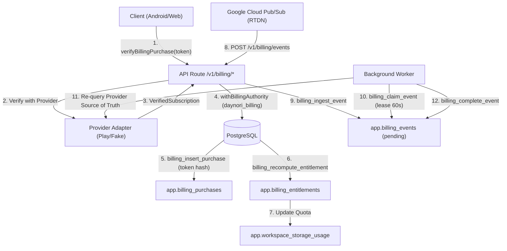

# Billing Operations and Reconciliation Guide

- Document Version: 1.0.0
- Date: 2026-11-06
- Status: Operating Runbook
- Target Roles: System Operators, Background Workers, Customer Support Staff
- Governing ADRs: [ADR 0054](../decisions/0054-billing-entitlements-and-purchase-lifecycle.md), [ADR 0068](../decisions/0068-feature-registry-personalization-and-operator-boundaries.md), [ADR 0089](../decisions/0089-billing-entitlements-and-sustainable-plan-readiness.md)

---

## 1. System Architecture Overview

Daynori's billing and entitlement system enforces strict server authority. Client devices never grant, extend, or revoke entitlements.



---

## 2. Subscription Lifecycle State Machine

Primary Source: [Google Play Billing Subscription Lifecycle](https://developer.android.com/google/play/billing/lifecycle/subscriptions).

| Google Play State (`subscriptionState`) | Daynori Status | Grants Paid Access? | Quota Applied | Operational Action |
|---|---|---|---|---|
| `SUBSCRIPTION_STATE_PENDING` | `pending` | **No** | Free default (100 MB) | Deferred payment or slow banking verification. Wait for RTDN. |
| `SUBSCRIPTION_STATE_ACTIVE` | `active` | **Yes** | Plus quota (10 GB) | Acknowledge purchase within 3 days. |
| `SUBSCRIPTION_STATE_IN_GRACE_PERIOD` | `grace` | **Yes** | Plus quota (10 GB) | Payment failed; Play is retrying. User notified to update payment method. |
| `SUBSCRIPTION_STATE_ON_HOLD` | `hold` | **No** | Free default (100 MB) | Grace period expired without payment. Access suspended; data preserved. |
| `SUBSCRIPTION_STATE_PAUSED` | `hold` | **No** | Free default (100 MB) | User paused subscription via Play Store. Access suspended; data preserved. |
| `SUBSCRIPTION_STATE_CANCELED` | `canceled` | **Yes** (until `validUntil`) | Plus quota (10 GB) | Auto-renewal turned off. User retains paid access until billing period ends. |
| `SUBSCRIPTION_STATE_EXPIRED` | `expired` | **No** | Free default (100 MB) | Subscription term finished. Entitlement reverts to free. Zero data deletion. |
| `SUBSCRIPTION_STATE_REVOKED` | `revoked` | **No** | Free default (100 MB) | Refunded or revoked by Google. Access immediately drops to free tier. |

---

## 3. Worker Reconciliation & Maintenance Jobs

Background jobs run under the `daynori_billing` database role. Ordinary API runtime accounts (`daynori_runtime`) have execute privileges revoked.

### 3.1 `billing_reconcile_events` Job
- **Schedule**: Periodic polling every 30–60 seconds, or immediate dispatch on event ingest.
- **Workflow**:
  1. `app.billing_list_pending_events(limit => 20)` fetches pending event IDs.
  2. For each event, `app.billing_claim_event(eventId, leaseSeconds => 60, leaseOwner)` locks the row atomically.
  3. Outside the database transaction, worker queries `provider.verifySubscription(token)` to get fresh authoritative state.
  4. In a new transaction, worker calls `app.billing_insert_purchase`, runs `app.billing_recompute_entitlement`, and calls `app.billing_complete_event(eventId, 'succeeded', null, leaseOwner)`.
- **Worker Crash Recovery**:
  - If a worker dies while holding a lease, `lease_until` expires after 60 seconds.
  - The next reconciliation worker claims the event automatically.
- **Poison Pill Handling**:
  - `attempt_count` increments on each claim.
  - If `attempt_count >= max_attempts` (default 8) or if the event payload has unresolvable missing tokens, the worker marks the event `'dead_letter'` and logs an alert.

### 3.2 `billing_expire_entitlements` Job
- **Schedule**: Every 60 seconds.
- **Function**: `app.billing_expire_stale_entitlements(limit => 50)`.
- **Logic**:
  - Identifies active, grace, hold, or canceled entitlements whose `valid_until <= now()`.
  - Re-evaluates all purchases for each expired user.
  - If no other valid paid purchase exists, recomputes entitlement to `free`, updates `app.workspace_storage_usage.max_storage_bytes = 104857600`, and sets status to `'expired'`.
  - **No user data is ever deleted**.

---

## 4. Conflict Resolution & Invariants

### 4.1 Out-of-Order RTDN Notifications
- **Issue**: Google Cloud Pub/Sub may deliver messages out of order (e.g. `SUBSCRIPTION_CANCELED` arrives 2 minutes after a subsequent `SUBSCRIPTION_RENEWED`).
- **Resolution**:
  - Worker **never** overwrites subscription state using RTDN event type strings.
  - The event type is logged in `app.billing_events` as a trigger.
  - The worker always queries the Google Play Developer API (`purchases.subscriptionsv2.get`) for current authoritative state.
  - In `app.billing_recompute_entitlement`, active purchases take priority over canceled purchases, which take priority over expired purchases (`ORDER BY CASE p.subscription_state ...`).

### 4.2 Cross-Account Token Reuse (Token Theft Defense)
- **Invariant**: A purchase token belongs strictly to the first authenticated account that verified it.
- **Enforcement**:
  - `app.billing_purchases` enforces `UNIQUE(provider, purchase_token_hash)`.
  - If Account B attempts `verifyPurchase` with Account A's token, the server returns `409 Conflict: BILLING_TOKEN_ACCOUNT_MISMATCH`.
  - In `restorePurchases`, Account B's restore skips Account A's token safely (`skippedCrossAccount += 1`), preventing user enumeration or error crashes.

### 4.3 Sensitive Token Hashing
- **Security Rule**: Raw purchase tokens must never be written to application logs, error traces, diagnostics, or Git.
- **Database Storage**:
  - `purchase_token_hash`: SHA-256 hex hash of the purchase token.
  - `provider_purchase_token_prefix`: First 12 characters only, used for human reference in support tickets.

---

## 5. Support & Operational Runbooks

### 5.1 User Inquiry: "I canceled my subscription, why do I still have Plus?"
- **Explanation**: Daynori honors the full period the user paid for. In accordance with Google Play subscription terms, cancellation stops future renewals, but the entitlement remains active (`canceled` state with `grantsPaidAccess = true`) until `validUntil`.

### 5.2 User Inquiry: "My subscription expired. Were my notes or files deleted?"
- **Explanation**: Reassure the user that Daynori guarantees **zero data loss on plan expiration**. All existing notes, routines, journal entries, tasks, and files remain fully accessible for viewing, downloading, exporting, and deleting. Only new file uploads that would exceed the 100 MB free tier limit are paused until capacity is freed.

### 5.3 Manual Entitlement Reconciliation Trigger
If a user reports an unreflected renewal:
1. Operator navigates to Developer tools or runs administrative CLI:
   ```bash
   pnpm --filter @daynori/worker exec node dist/cli/reconcile-user.js --userId <USER_UUID>
   ```
2. Or instruct the user to tap **"Restore purchases"** directly in Web `BillingPanel` or Android `BillingSheet`.

---

## 6. Audit & Release Verification Checklist

- [x] Database roles partitioned: `daynori_billing` owns billing mutations; `daynori_runtime` execution revoked.
- [x] Concurrency-safe quota enforcement via `reserveQuota` and `workspace_storage_usage`.
- [x] Over-quota writes fail closed with `QuotaExceededError`; reads/exports preserved.
- [x] Token hashing verified with SHA-256; zero plaintext tokens in logs.
- [x] All 24 billing tests pass (`tests/integration/phase89-billing-sustainable-readiness.test.ts`).
- [ ] Qualified Google Play merchant profile and production activation credentials verified with owner (blocked under `DEF-V2-007`).
