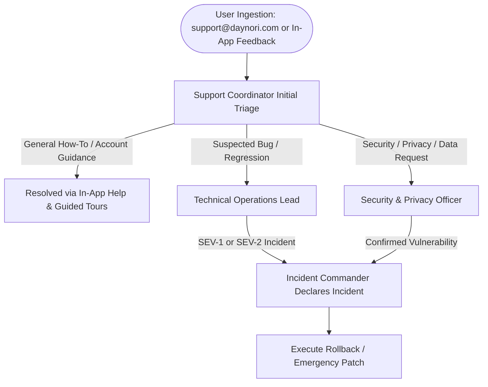

# Daynori Incident Response and User Support Operational Roster

## Overview & Operational Purpose

This document establishes the official operational roster, contact channels, severity definitions, service level objectives (SLOs), and escalation procedures for **Daynori** production operations, in accordance with [AGENTS.md](../../AGENTS.md) and [Phase 120](../phase-reports/phase-120.md).

No single individual or automated script constitutes a complete incident response team. This roster defines the human and automated operational responsibilities required before and after public launch.

---

## 1. Designated Operational Roster & Roles

| Role | Title / Identifier | Primary Responsibilities | Backup / Delegate |
| :--- | :--- | :--- | :--- |
| **Incident Commander (IC)** | Project Lead / Platform Owner | Overall incident authority, severity declaration, public communication approval, launch/cutover decision, rollback authorization, post-mortem scheduling. | Lead Systems Architect |
| **Technical Operations Lead** | Infrastructure & Database Engineer | Infrastructure health (Render, Cloudflare, Supabase), connection pool sizing, database restore drill execution, rollback execution, resource scaling. | Platform Engineer |
| **Security & Privacy Officer** | Security & Privacy Reviewer | Vulnerability triage, credential compromise containment, session revocation, suppression ledger audit, external vulnerability disclosure coordination (`security@daynori.com`). | Application Security Engineer |
| **Support & Communications Lead** | User Support Coordinator | User inquiry monitoring (`support@daynori.com`), user-facing incident status notices, feedback triage (`/v1/feedback`), privacy data request fulfillment. | Technical Writer / Product Specialist |

---

## 2. Ingestion Pathways & Monitored Channels

### 2.1 External User & Security Ingestion
1. **Security Vulnerability Disclosures:**
   - Email: `security@daynori.com`
   - Scope: Responsible disclosure of suspected authorization bypasses, IDOR, data leakage, cryptographic flaws, or dependency issues.
   - PGP Key: Fingerprint published on `https://daynori.com/.well-known/security.txt` upon public launch.
2. **User Support & Bug Inquiries:**
   - Email: `support@daynori.com`
   - In-App Endpoint: `POST /v1/feedback` (triaged by Operator Feedback triage dashboard).
   - In-App Help: `/help` tour guides and documentation.

### 2.2 Automated Operational Telemetry & Alerting
1. **Health Probes:** Continuous monitoring of `/api/health`, `/health`, and `/v1/health` with 60-second polling from dual geographic regions.
2. **Error Rate Alerts:** Webhook trigger to IC when HTTP 5xx responses exceed 1% over a 5-minute sliding window.
3. **Latency Alerts:** P95 response time exceeding 500ms on core organizer routes (`/notes`, `/tasks`, `/routines`, `/journal`).

---

## 3. Incident Severity Levels & Service Level Objectives (SLOs)

| Severity | Definition & Examples | Initial Acknowledgment | Target Mitigation / Containment | Update Frequency |
| :--- | :--- | :--- | :--- | :--- |
| **SEV-1 (Critical)** | Data loss, active vulnerability exploitation, cross-tenant isolation breach, broad service outage (> 50% users affected). | **< 15 minutes** | **< 1 hour** | Every 30 minutes |
| **SEV-2 (High)** | Core feature degraded (e.g. sync queue stalled, auth latency > 2s, error rate > 5%), single-tenant service disruption. | **< 1 hour** | **< 4 hours** | Every 2 hours |
| **SEV-3 (Medium)** | Non-blocking defect with available workaround, cosmetic UI regression, localized transient error. | **< 24 business hours** | **< 3 business days** | Upon milestone change |
| **SEV-4 (Low)** | User feedback, feature suggestion, documentation inaccuracy, minor lint/formatting anomaly. | **< 3 business days** | Next planned cycle | Upon closure |

---

## 4. Emergency Containment & Cutover Playbooks

### 4.1 Rapid Rollback Execution
When a deployment introduces a critical regression or security vulnerability:
1. IC declares SEV-1 or SEV-2.
2. Technical Ops Lead invokes the documented rollback procedure from `artifacts/phase118/rollback-package-runbook.md`.
3. Because all 80 database migrations are additive SQL, the API and Web services can be immediately redeployed to the predecessor candidate (`2.0.0-rc3` or `2.0.0-rc2`) with zero down-migrations.

### 4.2 Emergency Offline Cutover (Sub-10-Second Fallback)
If the backend API or database becomes completely unavailable:
1. Cloudflare Edge rule triggers instant failover to `/offline-shell.html`.
2. Users receive local IndexedDB read access, an outbox queue viewer, and explanatory status without uncaught white-screen exceptions.

### 4.3 Compromised Credential or Secret Revocation
In the event of an alleged secret leakage (e.g., Supabase JWT secret, database pool password):
1. Security Officer executes dual-key JWKS rotation or updates platform environment variables.
2. Compromised active tokens are bulk-inserted into `app.revoked_tokens` via SHA-256 hash.
3. Fastify `JwtVerifier` immediately rejects all revoked tokens with HTTP 401 (`TOKEN_REVOKED`).

---

## 5. User Support Escalation Pathways

