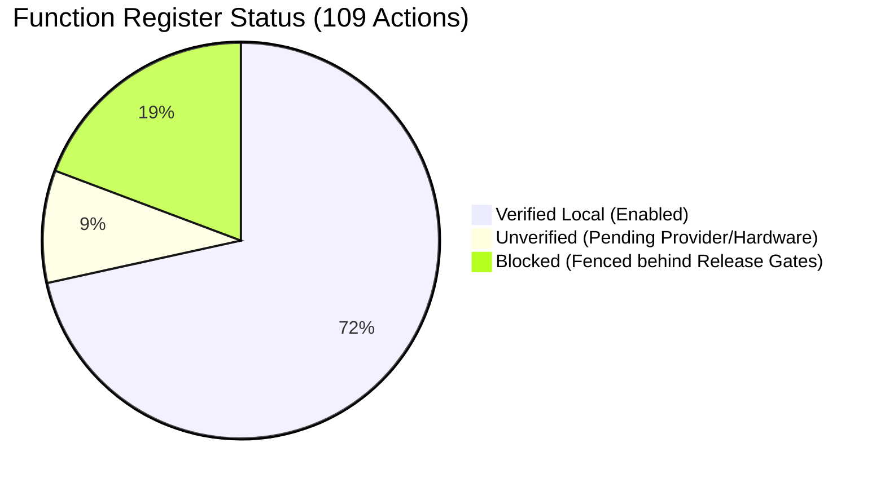

# Daynori Version 2 Release Candidate Manifest (2.0.0-rc1)

- **Status**: Candidate inspection and operational rehearsal only.
- **Date**: 2026-11-10.
- **Git HEAD**: `bf7a201f89508f267eda07d36c2eb32a62ac36cf` (branch `codex/free-core-preview`).
- **Release Eligibility**: **`releaseEligible: false`** (`notAnApprovalToLaunch: true`).
- **Governing ADRs**: [ADR 0057](../decisions/0057-public-release-preflight-and-first-publication.md), [ADR 0074](../decisions/0074-standing-phase71-scheduling-and-push.md), [ADR 0100](../decisions/0100-full-version-2-beta-and-readiness-reconciliation.md), [ADR 0101](../decisions/0101-version-2-release-candidate-and-operational-preparation.md).

> [!IMPORTANT]
> This manifest defines the complete scoped feature inventory for Version 2 candidate preparation. Under ADR 0057 and release preflight rules, engineering rehearsals do not grant launch authorization, approve publication, initiate store submission, activate paid services, or enable live provider calls.

---

## 1. Candidate Identity and Versions

| Component | Identifier / Version | Notes |
| :--- | :--- | :--- |
| **Monorepo Version** | `0.1.0` | Root monorepo version |
| **Web / PWA Version** | `0.1.0` | Production Next.js 15 build |
| **Mobile Version** | `0.1.0` | Expo 52 / React Native 0.76 |
| **Android Application ID** | `com.daynori.app` | Defined in `apps/mobile/app.json` |
| **Android Version Code** | `1` | Configured in `app.json` and inspected Gradle |
| **Android Version Name** | `0.1.0` | Matching mobile version |
| **Target SDK / Compile SDK** | `36` / `36` | Target API 36 required by Google Play policy |
| **Min SDK** | `24` | Android 7.0+ baseline |
| **URL Scheme** | `daynori://` | Configured deep link scheme |
| **Intent Filter Host** | `https://app.daynori.com` | Provisional domain pending owner DNS/domain setup |
| **Support / Inquiries** | `support@daynori.com` | Unresolved pending owner mailbox setup |

---

## 2. Candidate Artifacts & Inspection Hashes

### Web / PWA Production Artifacts
- **Build Engine**: Next.js 15.5.27 production build (`pnpm --filter @daynori/web build`).
- **PWA Manifest**: `apps/web/public/manifest.json`
  - SHA-256: `417FAAC1BD5C0D083657A7A69C645A2387C797E1AC60500F462D9DB3D280CF40`
  - Name: `Daynori`, Short Name: `Daynori`, Start URL: `/today`, Display: `standalone`, Theme Color: `#146B63`.
- **Service Worker**: `apps/web/public/sw.js`
  - SHA-256: `6E243130BED7D29E51C330A378380805F87539798692ABE5C4F8127BB1F70CB3`
  - Caches app shell, static assets, and essential help articles; never caches private user data or authenticated API responses.
- **Offline Shell**:
  - `apps/web/public/offline-shell.html` (SHA-256: `1B0BF5F65C8D7330D0560FE41ACC73A6A9806E9B7AFF5CB60DAACFC0FBD009CC`)
  - `apps/web/public/offline-shell.js` (SHA-256: `69649CDAB12D593DC7A9FED5607ABA0A22B9E5336E855D6117A9FD0CE0462E4F`)
- **Brand Icons**:
  - `icon-192.png`: `EAB6433ABBCA70B7392EAD34A499C1D901BC48FE4E849BFFF9EE43B66D6EEE64`
  - `icon-512.png`: `DC0EBF905510C9CAE68046262C198A76D11FA010BCAB53E3C1745BB8467B377E`
  - `icon-maskable-512.png`: `69D0B2D8A9438F3262692BA76AA64A9E547D5D4AAB718D6450B6395F5F868835`

### Android Release Build Status & Test Artifacts
- **Release Signing Guard**: Verified present and active (`apps/mobile/plugins/withReleaseSigningGuard.js`).
- **Fail-Closed Verification**: Gradle task-graph evaluation executes `:app:tasks` cleanly without credentials, and throws `GradleException: Release signing refused for distributable release task` on `:app:assembleRelease` when release keystore credentials are absent (`node scripts/mobile-android-release-path.mjs exercise-gradle` passed).
- **Signing Status**: **`BLOCKED`** pending authorized owner release signing material (`DAYNORI_RELEASE_STORE_*`).
- **Inspected Test Artifacts** (Engineering / test only — accurately labeled as debug-signed):
  - `artifacts/release/app-debug-arm64.apk` (56,991,982 bytes, SHA-256: `0379F71CB48C953C5020CB393BA49084507D1F37AFA06066622EB351C800A5B7`)
  - `artifacts/release/app-debug-x86_64.apk` (57,305,926 bytes, SHA-256: `E1F3EDAB678107EB0E5069F1A892D9ACC6297DE55DE2577C6E7D06C96A7B2CE9`)
  - `artifacts/release/app-embedded-x86_64.apk` (55,701,704 bytes, SHA-256: `D898E4A5A7D523A72DA2D742FDE000E8F8A80B7091C6C8963B2FB3064FBDBFBF`)

---

## 3. Function Register Reconciliation (109 Actions Across 22 Families)

### A. Enabled Scope (78 actions — `verified_local`)
The enabled candidate scope provides a complete, fast, accessible personal organizer:
1. **Account Foundation**: Welcome shell, personal workspace provisioning, display & theme preferences (`system`, `light`, `dark`), high-contrast, text scaling, in-app account deletion, and public web deletion request resource.
2. **Core Navigation**: Responsive top & bottom shells, directory of all features, feature personalization (hide/show modules), bottom shell tabs dynamic collapse (4 tabs down to 3 tabs when Journal is hidden).
3. **Tasks**: CRUD operations, completion toggle, undo, trash and restore, list filters, subtasks, deadline types (`none`, `date`, `timed`), priority levels (`low`, `normal`, `high`, `urgent`).
4. **Routines**: CRUD operations, occurrence generation, completion, skipping, undo, completion history, independent date tracking across time zones.
5. **Calendar**: Agenda feeds, event CRUD, canonical event cross-links to tasks and routines.
6. **Notes**: Rich structured note creation, editing, guidelines, hyperlinks, trash/restore, long documents ($>10,000$ items fixture verified).
7. **Journal**: Private journal entries, backdating, privacy snippets, reflections.
8. **Library & Folders**: 5-level nested folder hierarchies, move/reorder, saved views, mixed asset browsing.
9. **Scoped Search**: Instant full-text search scoped strictly to the authorized workspace tenant.
10. **Files & Attachments**: Upload reservations, SHA-256 checksum tracking, client finalization, quarantine verification, download capabilities, item attachment links.
11. **Audio Recording**: Voice note capture and audio attachment metadata.
12. **Custom Sections**: Approved custom section blocks, CRUD records, accessible non-drag reordering.
13. **Expenses**: Transaction logging, recurring expense templates, budget summaries, category reporting.
14. **Offline Sync & Outbox**: Offline mutation outbox persistence, auto-reconnect sequential replay, optimistic concurrency (`baseRevision`).
15. **User Support & Tours**: Contextual Help how-to search, bug/suggestion report submissions, 19 playable guided tour chapters (10 everyday, 5 advanced, 4 safe explanatory).
16. **Nori Companion**: Original vector mascot companion and assistant launcher.

---

### B. Unverified Scope (10 actions — `unverified`)
Actions implemented in source and local tests but lacking production account/provider verification:
- `account.sign-up`, `account.sign-in`, `account.recover-password`, `account.sign-out`: Depend on live third-party IdP provider and mail transport (`DEF-V2-001`).
- `search.offline-coverage`: Extended offline index cold-reboot durability.
- `offline.pending-queue`: Multi-day offline mutation queue edge-case recovery.
- `reminders.create-rule`: Local reminder evaluation scheduling rules.
- `reminders.web-push-subscribe`: Push subscription against live VAPID keys.
- `help.replay-beginner-guide`: Beginner guide tutorial full action coverage (`DEF-V2-012`).
- `account.privacy-terms`: Public terms deployment and verified legal entity URL.

---

### C. Gated Scope (21 actions — `blocked`)
Actions fenced fail-closed behind mandatory release gates; strictly disabled in candidate builds:
- **Reminders Device Delivery** (2 actions): Fenced behind `DEF-V2-002` (native push token registration and deep links).
- **Vault Zero-Knowledge Cryptography** (4 actions): Fenced behind `DEF-V2-004` (independent external qualified security review).
- **Google Drive Sync** (3 actions): Fenced behind `DEF-V2-005` (production Google OAuth client verification and token security).
- **Rooms Realtime Collaboration** (4 actions): Fenced behind `DEF-V2-006` (assigned staffed moderation officer and UGC policy compliance).
- **In-App Billing & Subscriptions** (3 actions): Fenced behind `DEF-V2-007` (owner merchant registration and live Play Billing setup).
- **AI LLM Assistant Streaming & Tools** (5 actions): Fenced behind `DEF-V2-008` (live model provider explicit approval and budget quota).

---

## 4. Open Release Gates & Responsible Roles

| Gate ID | Area | Status | Missing Evidence | Accountable Role | Next Action |
| :--- | :--- | :--- | :--- | :--- | :--- |
| **`OWNER-SIGNING-KEYS`** | Release | **BLOCKED** | Authorized Android release keystore & passwords | Release Engineer / Owner | Supply `DAYNORI_RELEASE_STORE_*` in secure CI |
| **`OWNER-RELEASE-AUTH`** | Release | **BLOCKED** | Owner launch approval and track/destination choice | Project Owner | Review package and authorize beta track |
| **`DEF-V2-004`** | Security | **BLOCKED** | Independent external audit of vault crypto | Security / Vault Lead | Commission external cryptographic audit |
| **`DEF-V2-008`** | AI / Biometrics | **BLOCKED** | Live LLM provider authorization & biometric Keystore | AI Operations Lead | Authorize synthetic provider test; test Keystore |
| **`DEF-V2-011`** | Hardware | **BLOCKED** | Physical ARM64 device startup & TalkBack profiling | QA / Accessibility Lead | Run test suite on physical Android hardware |
| **`DEF-V2-013`** | Usability | **BLOCKED** | Live sessions with $\ge 5$ consenting human users | UX Researcher / Owner | Execute 5-participant research protocol |
| **`DEF-V2-001`** | Auth | **OPEN** | Production Supabase/OAuth IdP configuration | Operations Lead | Provision production auth tenant |
| **`DEF-V2-002`** | Push | **OPEN** | Native FCM/APNs push provider credentials | Mobile Lead | Configure Firebase Cloud Messaging |
| **`DEF-V2-005`** | Integration | **OPEN** | Google Cloud OAuth production verification | Product Lead | Submit OAuth consent screen to Google |
| **`DEF-V2-006`** | Moderation | **OPEN** | Staffed moderation officer assignment | Moderation Officer | Staff moderation queue before rooms launch |
| **`DEF-V2-007`** | Billing | **OPEN** | Play Console merchant setup & commercial pricing | Financial Officer | Complete Google Play merchant registration |
